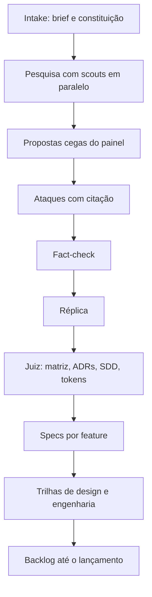

# open-debate

De uma ideia crua a um produto especificado, por debate entre agents.

Você descreve a ideia. Um painel de especialistas pesquisa, propõe às cegas, ataca as propostas uns dos outros citando arquivo e linha, passa por fact-check, e um juiz decide com matriz ponderada. O resultado é um conjunto de artefatos que um time consegue executar, não um texto de chat.

Roda dentro do [opencode](https://opencode.ai), como comando `/debate`.

```text
você:  /debate plataforma de triagem de alertas para SOC pequeno

fase 1 pesquisa: ok, 18 achados
fase 2 proposta: 4/4 ok, design reparado (contraste tinta/papel)
fase 3 ataque: 4/4 ok
fase 6 decisao: 5 ADRs, 4 specs
fase 8 backlog: 42 itens, 61 dias, caminho critico B01 -> B07 -> B19 -> B33
```

Os números acima ilustram o formato de saída.

## O que você recebe

| Artefato | Conteúdo |
|---|---|
| `research.md` | Achados com URL, prior art, preços e limites, lacunas |
| `decision.md`, `adr/` | Matriz ponderada e ADRs em MADR 4.0, com alternativa rejeitada e dissenso |
| `SDD.md` | Design doc arc42 enxuto, com C4 em mermaid, capacidade, falhas e STRIDE |
| `style-tile.html`, `tokens.json`, `tokens.css` | Direção visual com contraste WCAG 2.2 medido, tokens W3C DTCG |
| `specs/` | `spec.md`, `plan.md` e `tasks.md` por feature, no estilo GitHub Spec Kit, com requisitos EARS |
| `BACKLOG.md`, `backlog.csv`, `backlog.json`, `backlog-gh.sh` | Backlog até o lançamento, com dependências, estimativas e caminho crítico |

## Por que funciona

- **Proposta cega.** Cada especialista escreve antes de ver os outros, com modelos de famílias diferentes.
- **Ataque com evidência.** Veto precisa de citação literal, problema com número e troca concreta. Crítica sem concessão é descartada.
- **Número sem fonte é opinião.** Todo número cita `research.md` ou mostra a conta. O que o fact-check marca como errado vale zero na matriz.
- **Gates determinísticos.** Scripts, não LLM, verificam cada fase: contraste calculado, ADRs completos, dependências sem ciclo. Reprovou, o agent recebe o motivo e tem 1 chance de reparo.
- **Retoma de onde parou.** Cada fase é um arquivo. Limite de provider no meio do caminho não perde trabalho.

## Instalação

Requer [opencode](https://opencode.ai), `jq`, `perl` e um shell POSIX (macOS ou Linux).

```sh
npm i -g github:FelipeDiMarco/open-debate
open-debate init
```

Ou sem npm:

```sh
git clone https://github.com/FelipeDiMarco/open-debate.git && cd open-debate
./bin/open-debate init
```

`init` instala em `~/.config/opencode`. Para instalar só em um projeto, use `open-debate init --project`, que grava em `./.opencode`.

Depois, confira o ambiente e use:

```sh
open-debate doctor
opencode            # e dentro dele: /debate <sua ideia>
```

### Já tem uma instalação manual

`init` não sobrescreve arquivos que não reconhece: ele lista os conflitos e para. `open-debate init --force` guarda esses arquivos em `.open-debate-backup-*.tgz` e instala por cima, mantendo o `model:` de cada agent.

## Uso

### Na sessão do opencode

```text
/debate <ideia> [--painel arch,design,gcp,k8s] [--rounds 1-3] [--sem-pesquisa] [--sem-factcheck]
```

O agent faz até 6 perguntas de intake e conduz as fases. O caso fica em `cases/<slug>/`. Rodar `/debate` de novo sobre um caso existente retoma da primeira fase que não passa no gate.

### Na linha de comando

Para modelo pago ou self-hosted, CI e reexecução em lote. Modelos gratuitos do opencode recusam chamada headless, então use a sessão com eles.

```sh
caso=$(open-debate new "triagem de alertas")
$EDITOR "$caso/brief.md"
MODEL=<provider>/<modelo> open-debate run "$caso"
open-debate specs "$caso" ingestao triagem relatorio     # slugs do indice de decision.md
# preencha as specs e rode de novo para gerar o backlog
MODEL=<provider>/<modelo> open-debate run "$caso"
open-debate validate "$caso"
```

| Comando | Faz |
|---|---|
| `init`, `update`, `uninstall` | Gerenciam a instalação; aceitam `--project` e `--force` |
| `doctor` | Confere dependências, instalação e modelos |
| `models check\|apply\|free` | Confere, aplica ou lista modelos |
| `new`, `run`, `specs` | Criam e executam um caso |
| `gate`, `validate` | Rodam os gates de uma fase ou do caso inteiro |
| `backlog`, `tile` | Exportam o backlog e o style tile |

Variáveis do `run`: `MODEL`, `MODEL_FALLBACK`, `PAINEL`, `RETRIES=2`, `TIMEOUT=600`, `MIN_LINES=5`, `RESEARCH=1`, `FACTCHECK=1`, `REVIEW=1`, `REPAIR=1`, `FRESH=0`.

## O protocolo



| Fase | Agent | Gate |
|---|---|---|
| 0 intake | `debate` | brief sem campo vazio |
| 1 pesquisa | `debate-research`, `debate-scout` | 5+ URLs distintas, seção Lacunas |
| 2 proposta | painel | concessão; C4 e ADRs (arch); contraste e estados (design) |
| 3 ataque | painel | veto, citação literal, concessão |
| 4 fact-check | `debate-research` | não bloqueia |
| 5 réplica | painel | não bloqueia |
| 6 decisão e SDD | `debate-judge` | 3+ ADRs MADR, 3-6 specs, dissenso, SDD sem placeholder |
| 7 specs | `debate-arch`, `debate-design` | `validate` zera |
| 8 backlog | `debate-design`, `debate-arch`, `debate-pm` | 15+ itens, cobertura de specs, ADRs e lapidação, sem ciclos |

Detalhes em [`protocol.md`](template/skills/architect-debate/references/protocol.md) e nas [regras do debate](template/skills/architect-debate/references/regras-debate.md).

## Personalização

**Modelos.** `modelos.conf` define 1 modelo por agent. Os padrões são modelos gratuitos do opencode, que entram e saem do catálogo: rode `open-debate models check` antes de um debate longo, e `open-debate models apply` troca o que saiu pela reserva. Editar `modelos.conf` ou o `model:` de um agent sobrevive ao `update`. Para usar um provider próprio, aponte o agent para ele.

**Painel.** O painel padrão é `arch`, `design`, `gcp` e `k8s`, então a discussão de infraestrutura assume Google Cloud. Para outra nuvem, crie um agent `debate-aws.md` no modelo de `debate-gcp.md` e passe `--painel arch,design,aws`.

**Princípios.** `constitution.md` é copiado para cada caso, e o intake pode ajustá-lo. Violar um princípio exige override escrito.

## Limitações

- Templates, prompts e gates são em português: os artefatos saem em pt-BR.
- Os gates verificam forma e números, não a qualidade da decisão. Revise SDD e ADRs.
- O custo e a duração dependem dos modelos. Um debate completo faz dezenas de chamadas.
- Windows só via WSL.

## Desenvolvimento

```sh
npm test
```

A suíte não usa rede nem LLM: um `opencode` falso em `test/stub/` percorre o protocolo inteiro. Veja [CONTRIBUTING.md](CONTRIBUTING.md).

## Licença

[MIT](LICENSE)
