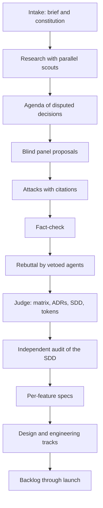

# open-debate

[](https://github.com/FelipeDiMarco/open-debate/actions/workflows/ci.yml)
[](LICENSE)

From a raw idea to a specified product, through a debate between agents, in the harness you already use.

You describe the idea. A panel of specialists researches it, agrees on which decisions are actually in dispute, proposes blindly, attacks each other's proposals citing file and line, goes through a fact-check, and a judge decides with a weighted matrix that an independent auditor then reviews. The result is a set of artifacts a team can execute, not a chat transcript.

```text
you:  /debate alert triage platform for a small SOC

fase 1 pesquisa: ok, 18 achados
fase 1b agenda: 5 decisoes em disputa
fase 2 proposta: 4/4 ok, design reparado (contraste tinta/papel)
fase 3 ataque: 4/4 ok
fase 6 decisao: 5 ADRs, 4 specs; auditoria: 1 defeito corrigido
fase 8 backlog: 42 itens, 61 dias, caminho critico B01 -> B07 -> B19 -> B33
```

The numbers above illustrate the output format. Agents and artifacts currently work in Brazilian Portuguese, see [Limitations](#limitations).

## Install

```sh
curl -fsSL https://raw.githubusercontent.com/FelipeDiMarco/open-debate/main/install.sh | sh
```

The installer puts the `open-debate` command in `~/.local/bin`, finds the harnesses on your machine and installs `/debate` in each one. Running it again updates. It requires macOS or Linux, `jq` and `perl`. On Windows, use WSL.

With Node, without a global install:

```sh
npx github:FelipeDiMarco/open-debate init
```

Then open your harness and run `/debate <your idea>`. To check your setup:

```sh
open-debate doctor          # dependencies and installation
open-debate doctor --live   # 1 real call on each installed harness
```

## Harnesses

| Harness | ID | Invocation | Panel runs as |
|---|---|---|---|
| [opencode](https://opencode.ai) | `opencode` | `/debate` | subagents, one model per agent |
| Claude Code | `claude` | `/debate` | subagents |
| Codex CLI | `codex` | `$debate` | subagents |
| Cursor | `cursor` | `/debate` | subagents |
| Gemini CLI | `gemini` | `/debate` | subagents |
| oh-my-pi | `omp` | `/skill:debate` | subagents |
| Factory Droid | `droid` | `/debate` | subagents |
| GitHub Copilot CLI | `copilot` | `/debate` | subagents |
| Qwen Code | `qwen` | `/debate` | subagents |
| Antigravity CLI | `agy` | `/debate` | headless processes |
| DeepSeek Harness | `dsh` | `/debate` | headless processes |
| Pi | `pi` | `/skill:debate` | headless processes |
| Cline | `cline` | `/debate` | headless processes |

Any other CLI with a headless mode also works, with no code changes. What differs between harnesses, and which ones were tested with real calls, is in [docs/harnesses.md](docs/harnesses.md).

`init` uses whatever it detects. To choose:

```sh
open-debate init --harness claude,codex    # only these
open-debate init --all                     # every supported harness
open-debate init --project                 # current project instead of user level
```

## What you get

| Artifact | Contents |
|---|---|
| `research.md` | Findings with URLs, prior art, prices and limits, gaps |
| `agenda.md` | The 3-8 decisions in dispute, with options, owner and deciding driver |
| `decision.md`, `adr/` | Weighted matrix and MADR 4.0 ADRs, with rejected alternatives, dissent and a ruling on every veto |
| `SDD.md`, `auditoria.md` | Lean arc42 design doc, with C4 in mermaid, capacity, failures and STRIDE, plus its independent audit |
| `style-tile.html`, `tokens.json`, `tokens.css` | Visual direction with measured WCAG 2.2 contrast, W3C DTCG tokens |
| `specs/` | `spec.md`, `plan.md` and `tasks.md` per feature, GitHub Spec Kit style, with EARS requirements |
| `BACKLOG.md`, `backlog.csv`, `backlog.json`, `backlog-gh.sh` | Backlog through launch, with dependencies, estimates and critical path |

## Why it works

- **A shared agenda.** The judge lists the disputed decisions before anyone proposes. Every proposal takes a position on each one, so the judge compares answers to the same questions.
- **Blind proposals.** Each specialist writes before seeing the others. From the command line, proposals and attacks run in a working directory that holds only what the agent may read.
- **Attacks need evidence.** A veto requires a literal quote, a problem with a number and a concrete replacement. The gate looks the quote up in the cited file and rejects it if it is not there. Every veto gets a ruling.
- **A number without a source is an opinion.** Every number cites `research.md` or shows the math, and a citation to a finding that does not exist is rejected. Whatever the fact-check marks wrong scores zero in the matrix.
- **The judge does not grade its own work.** An independent auditor lists provable defects in the SDD, and only those get corrected.
- **Deterministic gates.** Scripts, not an LLM, check each phase and redo the math: contrast, matrix totals, weights, capacity, spec task coverage, dependency cycles. On failure, the agent gets the reason and 1 repair attempt.
- **Resumes where it stopped.** Each phase is a file. A provider limit halfway through loses no work, and `status` shows where the case stands.

## Usage

### In a session

```text
/debate <idea> [--painel arch,design,gcp,k8s,sec] [--rounds 1-3] [--sem-pesquisa] [--sem-factcheck]
```

The agent asks up to 6 intake questions and runs the phases. The case lives in `cases/<slug>/`. Running `/debate` again on an existing case resumes from the first phase that fails its gate.

### From the command line

Runs the whole protocol, from research to backlog, with each specialist in an isolated process. Use it for CI, batch reruns and any harness with a headless mode. Nothing has to be installed in the harness, it only needs to be logged in.

```sh
case=$(open-debate new "alert triage")
$EDITOR "$case/brief.md"
open-debate run "$case" --harness claude
```

opencode's free models refuse headless calls, so use a session with them.

To see where a case stands, or to redo part of it after editing an earlier artifact:

```sh
open-debate status "$case"              # each phase, the next one, stale outputs, calls and model time
open-debate run "$case" --from ataque   # archives that phase and the later ones in raw/arquivo, then redoes them
```

`raw/metricas.tsv` records time, attempts and outcome per call, so you can see which phase is worth cutting. A rate limit waits with backoff; a login failure stops at once. `Ctrl-C` ends the calls in flight, and a second run on the same case is refused.

### Mixed panel

A debate gets better when opinions come from different model families. If you have access to more than one CLI, spread the panel across them:

```sh
open-debate run "$case" --harness claude --mesa claude,codex,gemini
```

`--harness` runs research, judge and backlog, and `--mesa` rotates the panel. See [per-agent routes](docs/harnesses.md#models).

### Commands

| Command | What it does |
|---|---|
| `init`, `update`, `uninstall` | Manage the installation; accept `--harness`, `--all`, `--project` and `--force` |
| `doctor [--live]` | Checks dependencies and installation; `--live` makes 1 real call |
| `harnesses` | Lists supported harnesses and the state of each |
| `models check\|apply\|free` | Check, apply or list opencode models |
| `new`, `run`, `status` | Create, execute and inspect a case |
| `specs` | Create specs by hand, for use with `SPECS=0` |
| `gate`, `validate` | Run the gates for one phase or the whole case |
| `backlog`, `tile` | Export the backlog and the style tile |

`run` variables: `HARNESS`, `MODEL`, `MODEL_FALLBACK`, `MESA`, `ROTAS`, `HARNESS_CMD`, `PAINEL`, `FROM`, `RETRIES=2`, `TIMEOUT=600`, `BACKOFF=20`, `PARALELO=6` (simultaneous calls, 0 for no limit), `MAX_CHAMADAS=0` (hard limit per run, 0 for none), `MIN_LINES=5`, `RESEARCH=1`, `AGENDA=1`, `FACTCHECK=1`, `SPECS=1`, `REVIEW=1` (audit), `REPAIR=1`, `FRESH=0`.

## The protocol



| Phase | Agent | Gate |
|---|---|---|
| 0 intake | orchestrator | no empty brief field |
| 1 research | `debate-research`, `debate-scout` | 5+ distinct URLs, 5+ findings with a source, gaps section |
| 1b agenda | `debate-judge` | 3-8 decisions, 2+ options, owner on the panel, deciding driver |
| 2 proposal | panel | position on every agenda item, concession, only existing finding ids, length; plus role checks (C4, contrast, cost and IAM, rollback, STRIDE) |
| 3 attack | panel | 1-3 vetoes, none against itself, quote found in the cited file, concession |
| 4 fact-check | `debate-research` | non-blocking |
| 5 rebuttal | vetoed agents | non-blocking |
| 6 decision and SDD | `debate-judge` | weights total 100, matrix math checks out, every agenda item, veto and wrong claim ruled on, 3+ MADR ADRs, 3-6 specs, dissent; SDD with every ADR, tokens identical to the decision, no placeholders |
| 6 audit | `debate-auditor` | verdict; defects go back to the judge |
| 7 specs | `debate-arch`, `debate-design` | EARS, cited ADRs exist, every user story has tasks |
| 8 backlog | `debate-design`, `debate-arch`, `debate-pm` | 15+ items, covers specs, tasks, ADRs and polish, no cycles, capacity math checks out and the plan fits |

Details in [`protocol.md`](template/skills/architect-debate/references/protocol.md) and the [debate rules](template/skills/architect-debate/references/regras-debate.md).

## Customization

**Models.** On opencode, `modelos.conf` sets 1 model per agent. The defaults are free models, which come and go from the catalog: run `open-debate models check` before a long debate. On other harnesses, the agent inherits the session model, and you can pin another on its `model` line. Your choice survives `update`.

**Panel.** The default panel is `arch`, `design`, `gcp` and `k8s`, so the infrastructure discussion assumes Google Cloud. Add `sec` when the product handles personal, financial or regulated data: `--painel arch,design,gcp,sec`. For another cloud, create a `debate-aws.md` persona modeled on `debate-gcp.md`, in `template/skills/architect-debate/personas/`, and pass `--painel arch,design,aws`.

**Principles.** `constitution.md` is copied into each case, and the intake can adjust it. Breaking a principle requires a written override.

## Limitations

- Templates, prompts and gates are in Portuguese, so artifacts come out in pt-BR.
- Gates check form, traceability and numbers, not decision quality. Review the SDD and ADRs.
- Blindness has limits. From the command line, the agent's working directory holds no rival output, but this is not an OS sandbox. In a session, blindness comes from the prompt naming only the allowed files, plus each harness's subagent isolation.
- Cost and duration depend on the models. A full debate makes dozens of calls.
- On a harness with a single model, proposals tend to look alike. Use a mixed panel.
- Windows only through WSL.

## Development

```sh
npm test
```

The suite uses no network or LLM: fake CLIs in `test/stub/` walk the whole protocol, one per harness. See [CONTRIBUTING.md](CONTRIBUTING.md) and [SECURITY.md](SECURITY.md).

## License

[MIT](LICENSE)
