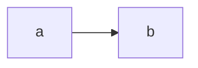

# SDD - Fixture

## 0. Resumo
Resumo com custo 100/mes.
## 1. Contexto e objetivo
Objetivo.
## 2. Restricoes, premissas e drivers
Prazo 8 semanas.
## 3. Decisoes
ADR-0001, ADR-0002, ADR-0003.
## 4. Arquitetura

## 5. Experiencia e direcao visual
**Conceito:** Torre de controle
```
TOKENS
papel #F2EFE8
superficie #FFFFFF
tinta #16181D
tinta-2 #4A4F5A
linha #D9D4C7
acento #0B5FFF
acento-tinta #FFFFFF
ok #1F6B3A
warn #8A5100
crit #A3231B
display Instrument Serif
body Inter
mono JetBrains Mono
escala 1.25 base 16
espaco 4
raio 6
movimento 180ms cubic-bezier(.2,.8,.2,1)
FIM
```
Vazio: 0 alertas.
Loading: 8 linhas.
Erro: falhou, tente de novo.
Sucesso: triado.
Parcial: 3 de 5.
## 6. Cortes e backlog
Cortes.
## 7. Testes de aceitacao, SLO e fitness functions
Testes.
## 8. Riscos, dissenso e perguntas abertas
Riscos.
