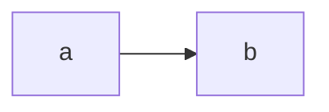

# SDD - Fixture

## 0. Summary
Summary with cost 100/month.
## 1. Context and goal
Goal.
## 2. Constraints, assumptions and drivers
Deadline 8 weeks.
## 3. Decisions
ADR-0001, ADR-0002, ADR-0003.
## 4. Architecture

## 5. Experience and visual direction
**Concept:** Control tower
```
TOKENS
paper #F2EFE8
surface #FFFFFF
ink #16181D
ink-2 #4A4F5A
line #D9D4C7
accent #0B5FFF
on-accent #FFFFFF
ok #1F6B3A
warn #8A5100
crit #A3231B
display Instrument Serif
body Inter
mono JetBrains Mono
scale 1.25 base 16
space 4
radius 6
motion 180ms cubic-bezier(.2,.8,.2,1)
END
```
Empty: 0 alerts.
Loading: 8 rows.
Error: failed, try again.
Success: triaged.
Partial: 3 of 5.
## 6. Cuts and backlog
Cuts.
## 7. Acceptance tests, SLO and fitness functions
Tests.
## 8. Risks, dissent and open questions
Risks.
