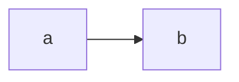

## Positions
D1: option A because it costs less
D2: outside my scope
D3: option B with evidence R1
1. Drivers: 50 rps peak -> p95 < 300 ms
2. Capacity: 100000/86400 = 1.2 rps
3. C4

8. Proposed ADRs: ADR modular monolith
10. Concession: gcp is right on cost
